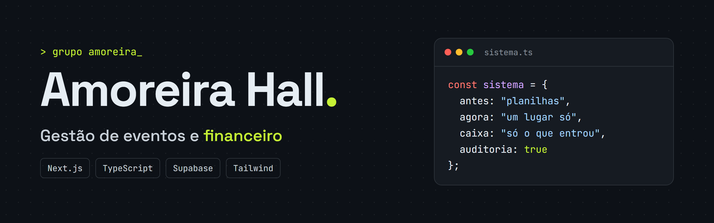
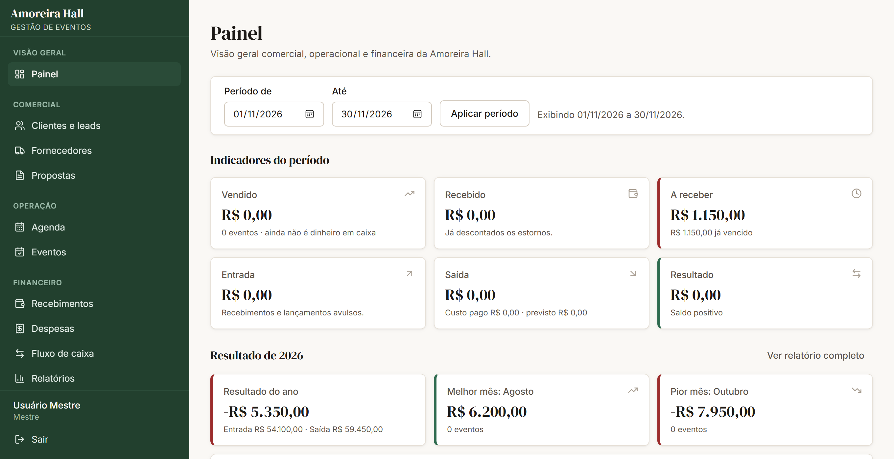
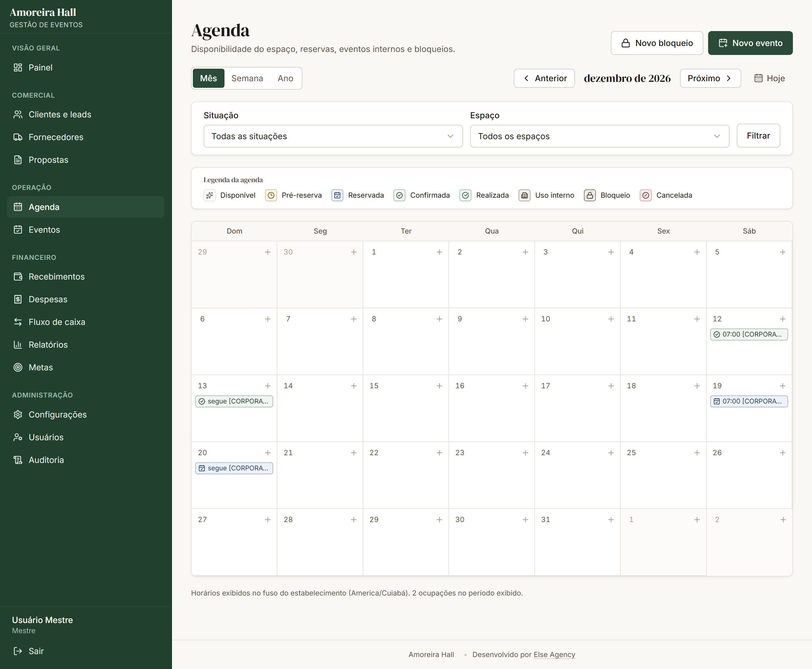
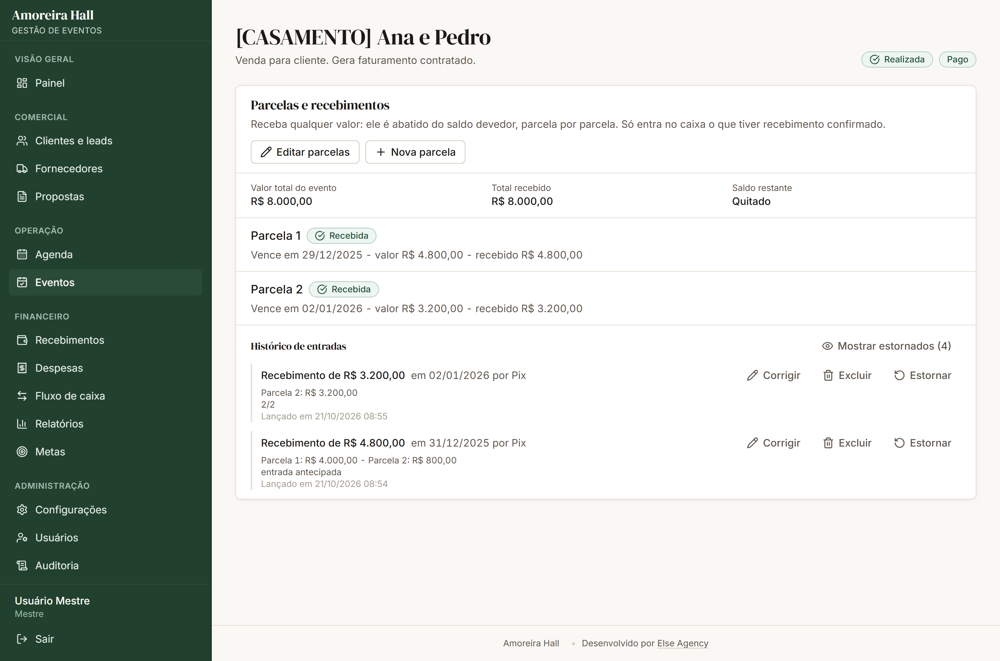
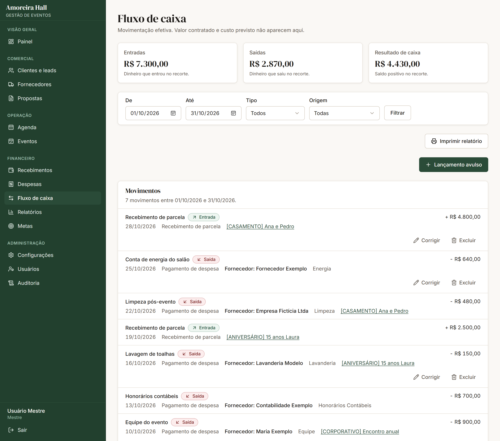

  

Trabalho no Grupo Amoreira, e a equipe do Amoreira Hall, o espaço de eventos do grupo, precisava de um jeito melhor de tocar o dia a dia. Reserva, cliente, parcela e despesa viviam em planilhas separadas, e fechar o mês dava trabalho. Então fiz um sistema para eles.

Ele está em produção e a equipe já lança tudo por lá. O código é privado por ser um sistema interno, por isso este repositório tem só a explicação do projeto. Os dados que aparecem nas imagens foram trocados por dados fictícios.

## O problema

O controle de contratos era uma planilha preenchida à mão, com uma linha por evento e uma coluna para cada data de pagamento. O cliente pagava R$ 500 num mês e R$ 1.500 no outro, e alguém precisava fazer a conta para saber o que ainda faltava. Para descobrir quanto foi pago a um fornecedor, a equipe escrevia o nome dele dentro da descrição do lançamento e depois procurava.

Outra confusão comum era misturar o valor vendido com o dinheiro que já tinha entrado. Um casamento fechado em janeiro para acontecer em dezembro é venda de janeiro, mas o dinheiro pode entrar aos poucos até lá.

## O que o sistema faz

Tudo fica num lugar só, do primeiro contato até o relatório do mês:

- **Comercial:** clientes, funil de oportunidades e propostas em PDF.
- **Agenda e eventos:** calendário do espaço, com bloqueio de reservas conflitantes no mesmo dia e horário.
- **Recebimentos:** parcelas com pagamento de valor livre. O valor é abatido do saldo do evento, da parcela mais antiga para a mais nova, e a tela mostra como vai ficar antes de confirmar.
- **Despesas e fornecedores:** cadastro de fornecedores, itens por despesa e busca livre que ignora acento, então "goncalves" encontra "Gonçalves".
- **Fluxo de caixa:** só entra o que foi recebido ou pago de verdade. Dá para corrigir um lançamento, e a correção vai para a origem dele.
- **Painel, metas e relatórios:** faturamento, recebido e a receber aparecem separados, com relatórios prontos para imprimir em A4.
- **Auditoria:** toda mudança de valor, data ou status fica registrada com autor, valor anterior e valor novo. Excluir não apaga: o registro sai das contas, exige um motivo e continua guardado.

## Imagens

  

<em>Painel</em>

  

<em>Agenda do espaço</em>

  

<em>Parcelas e histórico de recebimentos de um evento</em>

  

<em>Fluxo de caixa</em>

## Tecnologias

Também uso Zod para validar os dados e React PDF para gerar os documentos.

## Como eu fiz

Comecei escrevendo um documento com as regras do negócio, antes de qualquer tela, e fui entregando por módulo enquanto a equipe já usava o que estava pronto. Quase tudo que mudou depois veio de pedido do financeiro, muitas vezes por mensagem no WhatsApp. Desenvolvi com o Claude Code como parceiro de programação: eu definia o que fazer, conversava com a equipe e validava o resultado.

As regras importantes ficam no banco, para a tela não ser a única proteção. Dinheiro é guardado em centavos, nunca em número decimal. A entrada no caixa nasce de um gatilho no Postgres quando o recebimento é confirmado, e o acesso de cada perfil é controlado por Row Level Security. O banco tem 26 migrations versionadas.

Alguns problemas que me ensinaram bastante:

- **Lentidão entre as telas.** Cada navegação levava cerca de 1,7 s, porque a sessão era consultada três vezes em sequência. Depois de ajustar isso, caiu para perto de 450 ms. No relatório anual, as consultas ao banco foram de 52 para 4.
- **Pagamento que não bate com a parcela.** O sistema começou preso à ideia de um pagamento por parcela, e o cliente real não paga assim. Passei a tratar o recebido como saldo do evento e a distribuí-lo entre as parcelas, o que também permitiu editar o valor delas sem mexer no histórico.
- **Perda do projeto no Supabase.** O projeto original deixou de existir, e restaurei tudo num projeto novo a partir de um backup, comparando cada tabela com o arquivo original antes de voltar ao ar. Depois disso, coloquei um Cron diário na Vercel para o plano gratuito não pausar o banco.

## Testes

São 106 testes automatizados com Vitest, 70 testes de regras rodando direto no banco e 26 de permissões, que entram com cada perfil e tentam fazer o que ele não pode. Os testes de banco rodam dentro de uma transação desfeita no final, então não deixam dado nenhum para trás.

## Contato

